<div align="center">

<!-- ANIMATED BANNER: python scripts/banner/generate.py -->
<a href="https://github.com/MateoMg06">
  <picture>
    <source media="(prefers-color-scheme: dark)" srcset="assets/banner-dark.v9.svg">
    <source media="(prefers-color-scheme: light)" srcset="assets/banner-light.v9.svg">
    
  </picture>
</a>

<br>

<a href="https://github.com/MateoMg06">
  
</a>


</div>

---

## `$ whoami`

<p align="center">
  
</p>

<br>

<div align="center">

## `$ cat tech-stack.yaml`

<table border="1" cellpadding="14">
  <thead>
    <tr>
      <th colspan="2" align="left"><code>MateoMg06:~$ cat tech-stack.yaml</code></th>
    </tr>
  </thead>
  <tbody>
    <tr>
      <td width="50%" valign="top"><code>├─ ⚙ backend:</code><br><br>
        <br>
        <sub><code>Node.js · Express · TypeScript · JavaScript · JWT · bcrypt</code></sub>
      </td>
      <td width="50%" valign="top"><code>├─ ▣ databases:</code><br><br>
        
        <br>
        <sub><code>PostgreSQL · Sequelize ORM · SQL · Supabase</code></sub>
      </td>
    </tr>
    <tr>
      <td valign="top"><code>├─ ✦ frontend:</code><br><br>
        <br>
        <sub><code>React · Vite · Tailwind CSS · HTML · CSS</code></sub>
      </td>
      <td valign="top"><code>├─ ◉ tools_devops:</code><br><br>
        
        <br>
        <sub><code>Docker · Compose · Git · GitHub · Postman · Linux · Vercel · Swagger</code></sub>
      </td>
    </tr>
    <tr>
      <td colspan="2" valign="top"><code>╰─ ⌁ other:</code><br><br>
        
        
        <br>
        <sub><code>Python · Supabase Storage · EmailJS · Resend · Google reCAPTCHA</code></sub>
      </td>
    </tr>
  </tbody>
  <tfoot>
    <tr>
      <td colspan="2"><code>status: learning&nbsp;&nbsp;·&nbsp;&nbsp;environment: development → production</code></td>
    </tr>
  </tfoot>
</table>

</div>

---

## `$ curl localhost:3000/api/signals`

<p align="center">
  <picture>
    <source media="(prefers-color-scheme: dark)" srcset="assets/radar-dark.svg">
    <source media="(prefers-color-scheme: light)" srcset="assets/radar-light.svg">
    
  </picture>&nbsp;
  <picture>
    <source media="(prefers-color-scheme: dark)" srcset="assets/radar-langs-dark.svg">
    <source media="(prefers-color-scheme: light)" srcset="assets/radar-langs-light.svg">
    
  </picture>
</p>

<p align="center"><sub><code>signals: backend_skill_radar · language_stack_radar · status: 200 OK</code></sub></p>

---

## `$ ls ~/projects`

<table>
  <tr>
    <td width="50%" valign="top">
      <h3>🎬 Riwi TV</h3>
      API REST para una plataforma de gestión de cines: usuarios y autenticación, países, departamentos y ciudades, cines, películas y funciones.<br><br>
      <code>Routes → Middlewares → Controllers → Services → Repositories → Sequelize → PostgreSQL</code><br><br>
      <br>
      <sub>Sequelize · JWT · Swagger / OpenAPI</sub>
    </td>
    <td width="50%" valign="top">
      <h3>🛥️ Smile and Wave Charters</h3>
      Marketplace full-stack de yates: autenticación, publicaciones, almacenamiento de imágenes, panel de administración, campañas, cupones, verificación de email y recuperación de contraseña.<br><br>
      <code>Routes → Controllers → Services → Repositories → PostgreSQL</code><br><br>
      <br>
      <sub>JWT · Cookies · Supabase Storage · Resend</sub>
    </td>
  </tr>
  <tr>
    <td valign="top">
      <h3>💄 Glam Studio Catalog</h3>
      Catálogo de productos con categorías, marcas, productos y gestión de precios. Incluye migraciones y seeders de base de datos.<br><br>
      
    </td>
    <td valign="top">
      <h3>⚡ VC Energía</h3>
      Landing page corporativa con formulario de contacto protegido.<br><br>
      <br>
      <sub>EmailJS · Google reCAPTCHA</sub>
    </td>
  </tr>
</table>

---

## `$ cat roadmap.md`

```diff
+ Convertirme en Backend Developer profesional
+ Dominar Node.js, TypeScript, PostgreSQL y el diseño de bases de datos
+ Profundizar en arquitectura de software y patrones de diseño
+ Mejorar mis habilidades de testing
+ Construir APIs escalables y mantenibles
+ Aprender más de DevOps y despliegue en la nube
+ Seguir construyendo proyectos reales y completos
```

---

## `$ connect --socials`

<div align="center">

<a href="https://github.com/MateoMg06">
  
</a>
<a href="https://portafolio-remake.vercel.app">
  
</a>

</div>

<br>
<br>

<div align="center">
<sub>⭐ Siempre aprendiendo, construyendo y mejorando como desarrollador · @MateoMg06</sub>
</div>
